<p align="center">
  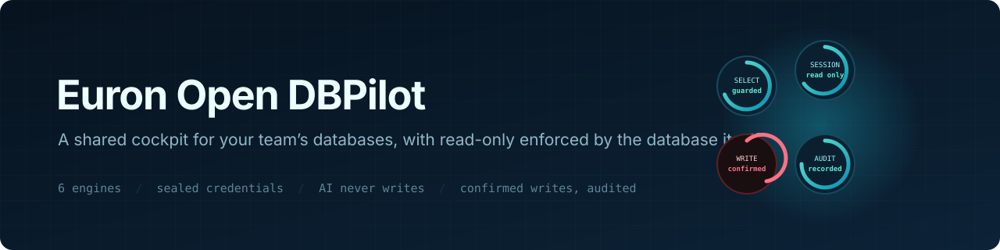
</p>

<p align="center">
  
  <a href="LICENSE"></a>
  
  
  
  
  
  
</p>

<p align="center">
  <a href="https://github.com/euron-sde-team/euron-open-dbpilot/stargazers"></a>
  <a href="https://github.com/euron-sde-team/euron-open-dbpilot/fork"></a>
  <a href="https://github.com/euron-sde-team/euron-open-dbpilot/watchers"></a>
  <br>
  <a href="https://github.com/euron-sde-team/euron-open-dbpilot/issues"></a>
  <a href="https://github.com/euron-sde-team/euron-open-dbpilot/pulls"></a>
  <a href="https://github.com/euron-sde-team/euron-open-dbpilot/commits/main"></a>
  
  <br>
  <a href="#built-by-the-team-behind-euron"></a>
</p>

<p align="center">
  <b><a href="#-quickstart">Quickstart</a></b> ·
  <b><a href="#️-architecture">Architecture</a></b> ·
  <b><a href="#-explore-the-repository">Explore the repo</a></b> ·
  <b><a href="docs/api/openapi.yaml">API reference</a></b> ·
  <b><a href="#️-deploy-to-aws">Deploy</a></b> ·
  <b><a href="docs/architecture/security.md">Security</a></b> ·
  <b><a href="#-documentation">Docs</a></b>
</p>

**Euron Open DBPilot** is an open-source, MIT-licensed, self-hosted, team-shared database
operations dashboard, part of the open-source initiative of **ENGAGESPHERE TECHNOLOGY
PRIVATE LIMITED**. A team registers a database connection once (PostgreSQL, MySQL,
SQLite, SQL Server, MongoDB or Redis), and every teammate who signs in can browse its
schema, run queries and watch its health, without ever holding that database's own
credential.

It exists because every comparable tool (Beekeeper Studio, DBeaver, pgAdmin, TablePlus)
stores the raw database password on each developer's own machine and shares it out of
band, and none of them make a database-enforced read-only boundary a first-class, free
feature:

- **Read-only is a database-enforced boundary, not a UI convention.** Every query that
  is not deliberately marked a write is checked by the SQL guard, then runs on a session
  the connected database itself holds read-only wherever the engine supports one, so a
  statement that slipped past the guard still cannot write.
- **An AI-generated statement never writes. Full stop.** No flag, no approval screen, no
  override anywhere, for any reason.
- **A human-marked write needs two separate things to execute**: a one-time token and a
  digest of the exact statement, with three audit entries recording the whole trail.
- **Credentials never leave the server.** A connection's password is sealed with envelope
  encryption and never returned by any API response, ever.

The whole stack runs on a laptop against a local AWS emulator, and the same Terraform
that provisions it validates cleanly for a real AWS deployment.

<p align="center">
  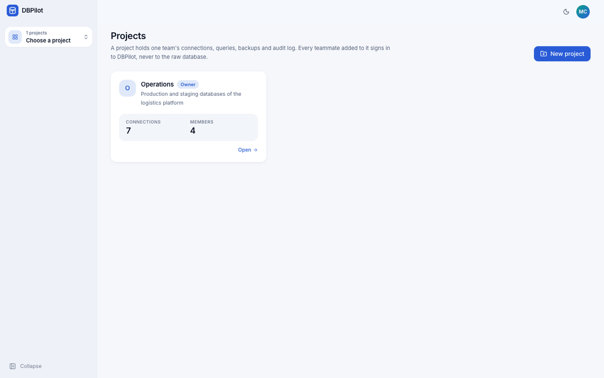
</p>

> [!NOTE]
> Everything in the tour ran for real: Docker Compose on a laptop, with S3 and KMS
> emulated locally (Floci) and provisioned by the same Terraform modules that build
> production. `make up && make demo` reproduces it, including DBPilot's AI assistant
> refusing a generated write live and a human-confirmed write producing a real audit
> trail.

<h3 align="center">Built by the team behind Euron</h3>

<p align="center">Euron Open DBPilot comes from the people who build these platforms. If you like how this repository is built, come and see what we build with it.</p>

<p align="center">
  <a href="https://euron.one"><picture><source media="(prefers-color-scheme: dark)" srcset="docs/assets/brand/euron-dark.svg"></picture></a>
  <a href="https://euronsystems.com"><picture><source media="(prefers-color-scheme: dark)" srcset="docs/assets/brand/euron-systems-dark.svg"></picture></a>
  <a href="https://alphaeuron.com"><picture><source media="(prefers-color-scheme: dark)" srcset="docs/assets/brand/alpha-euron-dark.svg"></picture></a>
</p>

<p align="center">
  <a href="https://www.instagram.com/euron_official"></a>
  <a href="https://www.linkedin.com/company/euronone/posts/"></a>
  <a href="https://x.com/euron712"></a>
  <a href="https://www.youtube.com/@Euron-official"></a>
  <a href="https://whatsapp.com/channel/0029VaeeJwq9RZAfPW9P2l07"></a>
</p>

---

## 📚 Table of contents

- [Why Euron Open DBPilot](#-why-euron-open-dbpilot)
- [At a glance](#-at-a-glance)
- [Screenshots](#️-screenshots)
- [Features](#-features)
- [Architecture](#️-architecture)
- [Tech stack](#-tech-stack)
- [Prerequisites](#-prerequisites)
- [Quickstart](#-quickstart)
- [Explore the repository](#-explore-the-repository)
- [API](#-api)
- [Configuration](#️-configuration)
- [Deploy to AWS](#️-deploy-to-aws)
- [Security model](#-security-model)
- [Testing](#-testing)
- [Documentation](#-documentation)
- [Roadmap](#️-roadmap)
- [FAQ](#-faq)
- [Contributing, security and license](#-contributing-security-and-license)

---

## 💡 Why Euron Open DBPilot

Beekeeper Studio and TablePlus are the UX benchmark for a SQL editor but have no team
concept and no web access. DBeaver's AI assistant and most governance features sit behind
a paid PRO tier, and it is single-user by design. pgAdmin is Postgres-only and
single-user. Metabase comes closest to "team dashboard over data," but it is a BI tool:
no schema editing, no backups, no server monitoring, and its AI usage governance is
Pro-only. None of them make a database-enforced read-only boundary, sealed credentials, or
backup/migration visibility a first-class free feature.

- **A real database-level guarantee, not a display convention.** Outerbase shows an
  AI-generated query before running it, a good pattern, but nothing enforces that the
  query cannot write once it runs. DBPilot opens the underlying connection itself
  read-only wherever the engine supports it, so a statement that somehow gets past the SQL
  guard still cannot write.
- **No open-core bait-and-switch.** DBPilot is MIT, fully usable from `docker compose up`,
  with nothing held back behind a paid tier.
- **A real multi-engine connector layer.** PostgreSQL and MySQL are first class; SQLite
  and SQL Server follow the identical read-only-connection pattern; MongoDB and Redis get
  their own read-only explorer and query surface rather than being forced through a SQL
  abstraction that does not fit them.
- **Self-hosted, with a real path to AWS.** `make up` runs the whole stack, Postgres
  through the dashboard, against a local emulator; the same Terraform validates for
  `aws-dev` and `aws-prod`, and `storage=s3`/`key_mode=kms` are genuinely exercised
  against it, not just provisioned and ignored.

## 📊 At a glance

| | |
| --- | --- |
| **Connectors** | PostgreSQL, MySQL, SQLite (uploaded file), SQL Server, MongoDB, Redis |
| **Safety** | Database-enforced read-only (per-engine session setting or connector design), a planner-estimate scan limit checked before execution, a row-limit truncation flag, sealed connection secrets never returned by the API |
| **AI assistant** | Natural-language-to-SQL against the real discovered schema; any statement that is not exactly one read-only query is refused, unconditionally, with no override |
| **Confirmed writes** | A one-time token plus a digest of the exact statement; three audit entries per write (requested, confirmed, executed); the identical path backs restores and migrations |
| **Isolation** | Project roles (owner/admin/viewer) plus a connection-level grant model; a connection with no grant answers 404, never 403 |
| **Tests** | 206 backend unit tests, 65 web unit tests, 113 integration tests (83% coverage), 4/4 test-matrix combinations, 15 e2e tests, 96 browser QA page views, 0 problems |
| **Infrastructure** | 9 Terraform modules, 3 environments (local-floci, aws-dev, aws-prod), checkov clean, a full aws-dev apply/re-plan/destroy against a throwaway Floci with zero adds or replacements on re-plan |
| **License** | MIT |

## 🖼️ Screenshots

<table>
  <tr>
    <td width="50%"><br><sub><b>Projects.</b> Every project you belong to, your role in each.</sub></td>
    <td width="50%">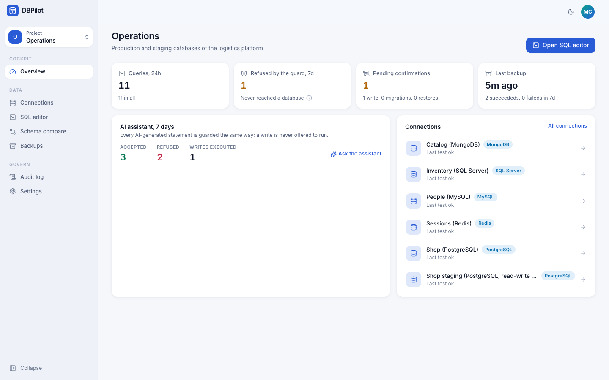<br><sub><b>Overview.</b> Connection health cards and org-wide totals, cached 15 seconds.</sub></td>
  </tr>
  <tr>
    <td>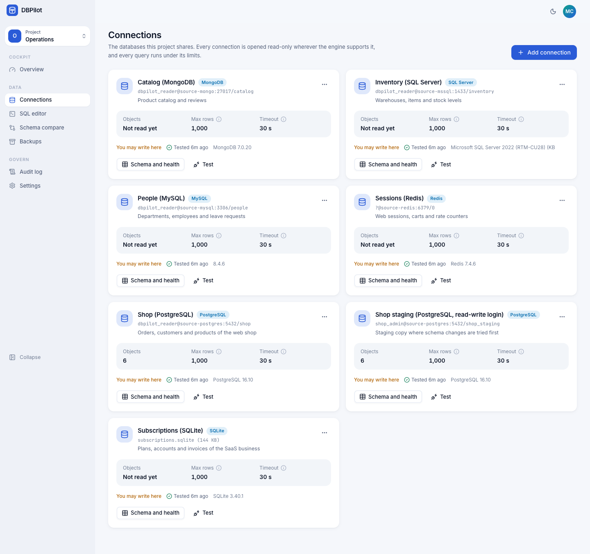<br><sub><b>Connections.</b> Every engine, one card each, no secret in sight.</sub></td>
    <td>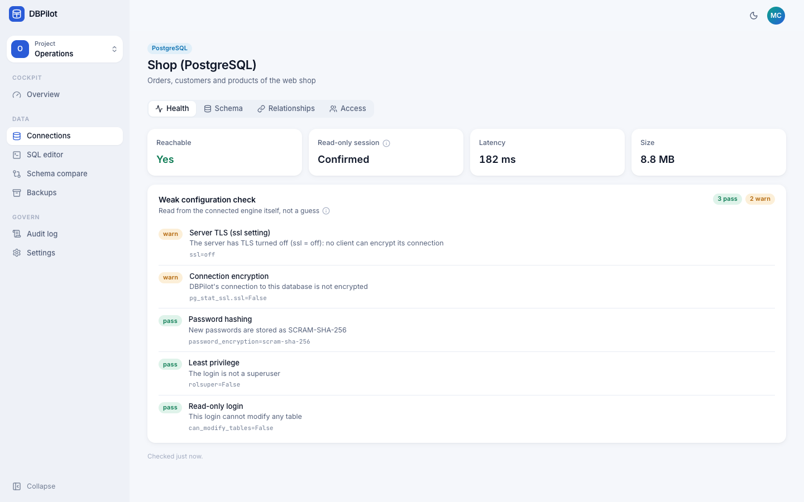<br><sub><b>Schema explorer.</b> Real discovery: tables, columns, indexes, foreign keys.</sub></td>
  </tr>
  <tr>
    <td>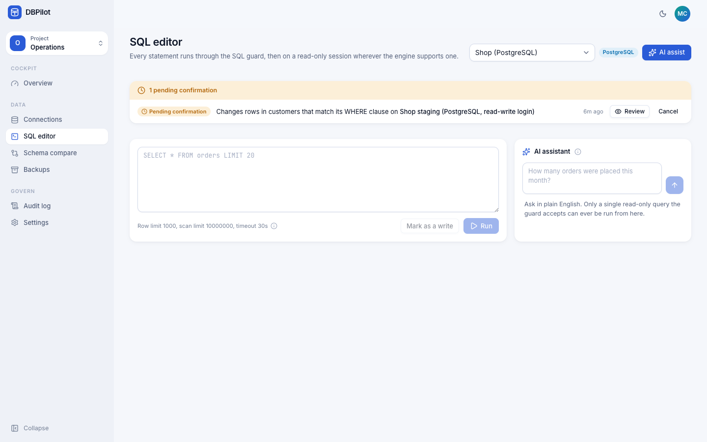<br><sub><b>SQL editor + AI.</b> A generated statement, shown with its guard verdict before it can run.</sub></td>
    <td>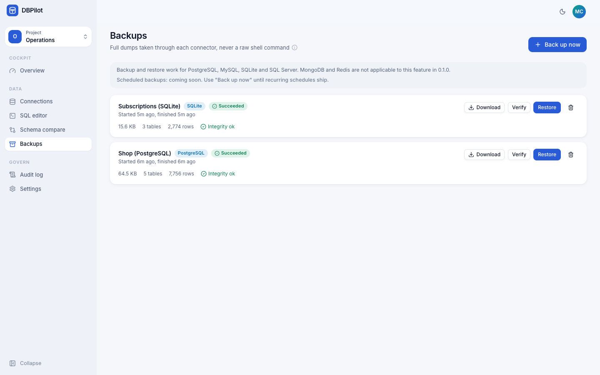<br><sub><b>Backups.</b> Manual backups with a real integrity check.</sub></td>
  </tr>
  <tr>
    <td>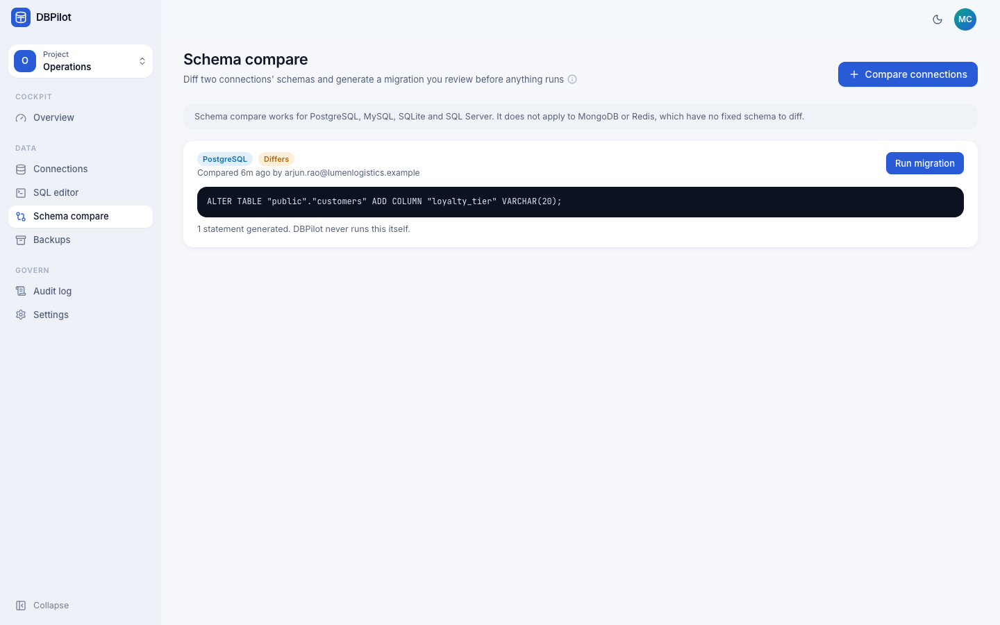<br><sub><b>Schema compare.</b> A diff and a generated migration script, human-reviewed.</sub></td>
    <td>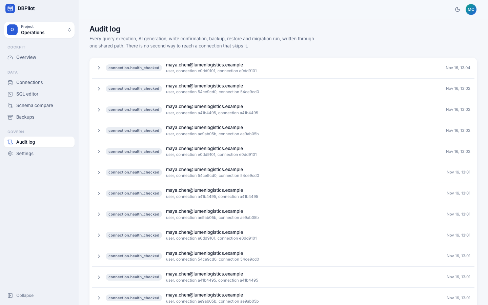<br><sub><b>Audit log.</b> Every query, confirmation, backup and restore, newest first.</sub></td>
  </tr>
  <tr>
    <td>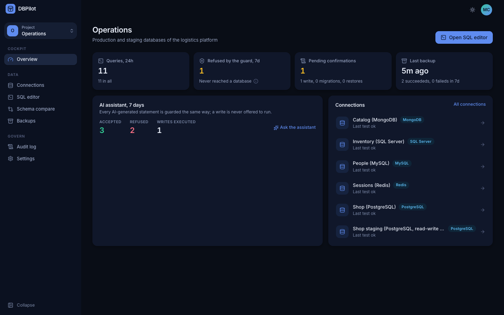<br><sub><b>Dark mode.</b> Every page, dark and light.</sub></td>
    <td>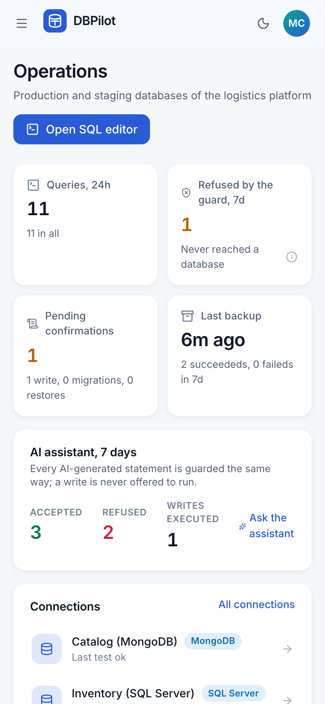<br><sub><b>Responsive.</b> Down to phone width.</sub></td>
  </tr>
</table>

## ✨ Features

| Area | What you get |
| --- | --- |
| **Connections** | Saved connection profiles for 6 engines, connection testing, per-connection safety limits (`max_rows`, `max_scan_rows`, `timeout_s`), sealed secrets never returned by the API |
| **Database explorer** | Tables/collections, columns, indexes, foreign keys, row-count estimates, an ER-style relationship view for SQL engines, row preview, from real schema discovery |
| **SQL workspace** | Syntax-aware editing, autocomplete seeded from the real schema, query history, saved queries, CSV/JSON export, result pagination |
| **MongoDB and Redis panels** | A dedicated filter/aggregate builder and a key browser plus a read-only command allowlist, not a forced SQL abstraction |
| **AI database assistant** | Natural-language-to-SQL, SQL explanation, index suggestions, error diagnosis, all against the real connected schema; never writes |
| **Confirmed writes** | A described statement, a one-time token, a digest; nothing runs until both come back matching |
| **Performance monitoring** | A health card per connection (reachability, size/row counts, a real weak-configuration check), slow-query surfacing where the engine exposes it natively |
| **Backups** | Manual and scheduled full backups through the connector layer, integrity-checked, restore gated behind the same confirmation as a write |
| **Schema comparison** | A diff between two schema snapshots and a generated migration script a human reviews and runs |
| **Access control** | Project roles plus connection grants; a connection with no grant 404s, never 403s |
| **Audit log** | Every query, AI generation, confirmation step, backup, restore and migration run, through one shared write path |
| **Dashboard** | Sign in, Projects, Overview, Connections, SQL editor with AI assist, Backups, Schema comparisons, Audit log, Settings, System. Dark and light |
| **Admin API** | Everything the dashboard does, under `/api/v1`, OpenAPI documented |
| **CLI** (`dbpilot`) | `serve`, `worker`, `migrate`, `revision`, `openapi`, `create-admin`, `seed`, `mockai` |

## 🏗️ Architecture

<p align="center">
  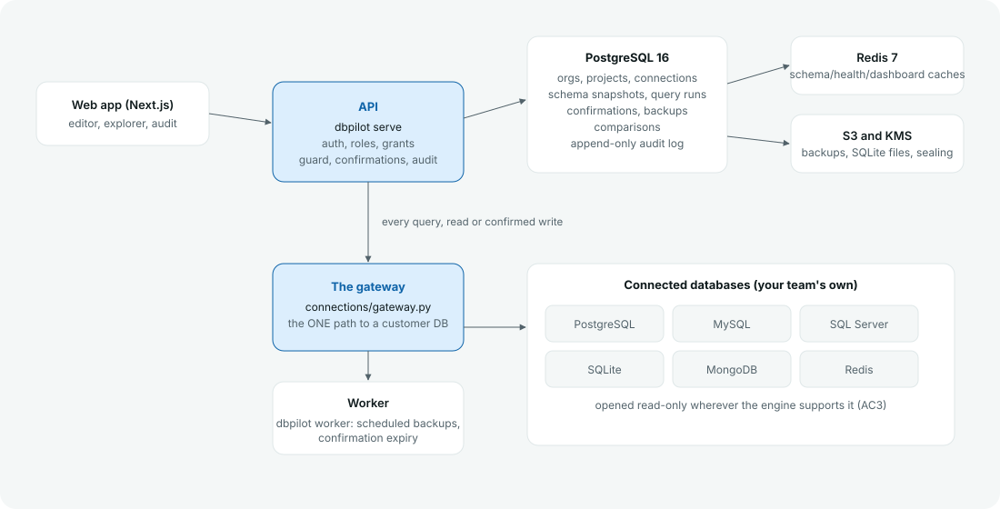
</p>

The API is packaged by domain (`orgs`, `projects`, `auth`, `connections`, `schema`,
`queries`, `ai`, `confirmations`, `backups`, `comparisons`, `monitoring`, `dashboard`,
`audit`), each following router to service to models, the same layering throughout.
`connections/gateway.py` is the one door to a connected database: every query, read or
confirmed write, goes through it, picks up the read-only session enforcement, and writes
its audit entry. See [HLD.md](docs/architecture/HLD.md) and
[LLD.md](docs/architecture/LLD.md) for the full design, and
[data-model.md](docs/architecture/data-model.md) for the schema.

<p align="center">
  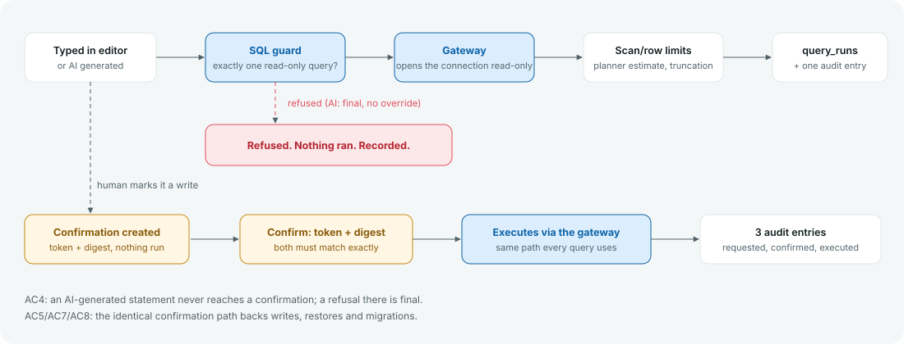
</p>

## 🧰 Tech stack

| Layer | Choice |
| --- | --- |
| Backend | Python 3.12, FastAPI, Pydantic v2, SQLAlchemy 2.0 async, Alembic migrations |
| Database | PostgreSQL 16 |
| Cache / KV | Redis 7, with an in-process fallback when Redis is not configured |
| Frontend | Next.js 15 App Router, React 19, TypeScript strict, Tailwind, TanStack Query |
| Connectors | psycopg, PyMySQL, pymssql, pymongo, redis-py, sqlite3; `sqlglot` for the SQL guard |
| Infrastructure as code | Terraform, modules for network, database, cache, storage, KMS, secrets, ECR, service, observability |
| Local AWS | Floci (MIT), provisioned by the same Terraform modules as production |
| Tests | pytest, Vitest, Playwright, Puppeteer browser QA |

## 📋 Prerequisites

| Tool | Version | Used for |
| --- | --- | --- |
| [Docker](https://docs.docker.com/get-docker/) with Compose v2 | 24+ | The local stack |
| [uv](https://docs.astral.sh/uv/) | latest | Running the API tests outside Docker |
| [Node.js](https://nodejs.org/) | 22 LTS | Building and testing the web app and e2e outside Docker |
| [pnpm](https://pnpm.io/) | 9 (`corepack enable`) | The web app and e2e package manager |
| [Terraform](https://developer.hashicorp.com/terraform/install) | 1.16+ | Only for deploying to AWS (local runs use a pinned container) |

## 🚀 Quickstart

```bash
git clone https://github.com/euron-sde-team/euron-open-dbpilot.git
cd euron-open-dbpilot

make env     # generate deploy/compose/.env with random local secrets
make up      # Postgres, Redis, Floci (Terraform-provisioned), 5 demo source databases,
            # mock AI, the worker, api, web
make demo    # a seeded organization: connections, query history, backups, a comparison
```

| Open | As |
| --- | --- |
| http://localhost:5810 | `maya.chen@lumenlogistics.example` / the `DBPILOT_DEMO_PASSWORD` value |
| http://localhost:5830/docs | The API's interactive docs |
| http://localhost:5825 | Every email the stack sends (Mailpit) |

`make down` stops everything and deletes the local data.

[Full local guide](docs/guides/quickstart-local.md) ·
[Run locally against real AWS](docs/guides/local-with-aws.md) ·
[Troubleshooting](docs/guides/troubleshooting.md)

## 🧭 Explore the repository

```text
euron-open-dbpilot/
├── apps/
│   ├── api/                 FastAPI service
│   │   └── src/dbpilot/
│   │       ├── core/             config, db, kv, sealing, storage, security, errors
│   │       ├── orgs/               organizations, users
│   │       ├── projects/           the scoping boundary for connections and queries
│   │       ├── auth/               sessions, revoked sessions
│   │       ├── connections/        connections, grants, access.py (AC9), gateway.py
│   │       │   └── connectors/      per-engine dispatch, openers.py (read-only, AC3)
│   │       ├── schema/             schema snapshot discovery and cache
│   │       ├── queries/            guard.py (the SQL guard), the query-run path
│   │       ├── ai/                 natural-language-to-SQL, explanation, advice
│   │       ├── confirmations/      the two-step confirm (write, migration, restore)
│   │       ├── backups/            manual and scheduled backups, restore
│   │       ├── comparisons/        schema comparison and migration scripts
│   │       ├── monitoring/         health cards, weak-configuration checks
│   │       ├── dashboard/          org-wide aggregates (cached)
│   │       ├── audit/              the one write path for the audit log
│   │       └── demo/               the `dbpilot seed` demo data
│   └── web/                 Next.js dashboard
├── e2e/                      Playwright suites
├── infra/terraform/          modules/ + envs/{local-floci,aws-dev,aws-prod}
├── deploy/compose/           compose.yaml, compose.floci.yaml, compose.aws.yaml
├── docs/                     architecture, ADRs, guides, OpenAPI
└── scripts/                  test matrix, sanitization check, Puppeteer QA
```

**Where to start reading:**

| To understand | Read |
| --- | --- |
| How a query becomes a result | `queries/service.py`, then `connections/gateway.py` |
| How read-only is enforced per engine | `connections/connectors/openers.py`, then [security.md](docs/architecture/security.md) |
| How the AI assistant is kept from writing | `ai/service.py`, `queries/guard.py`, then [ADR-0002](docs/architecture/adr/0002-ai-never-writes.md) |
| How a confirmed write actually runs | `confirmations/service.py`, then [ADR-0003](docs/architecture/adr/0003-two-step-confirm-token-and-digest.md) |
| How connection access is scoped | `connections/access.py`, then [data-model.md](docs/architecture/data-model.md) |
| How the scheduled-backup worker runs | `worker.py`, then [HLD.md](docs/architecture/HLD.md) |

The [walkthrough](docs/guides/walkthrough.md) tours the dashboard page by page.

## 🔌 API

The [OpenAPI reference](docs/api/openapi.yaml) is exported directly from the running
FastAPI app (`make openapi`), so it cannot drift from the code.

```bash
curl -s http://localhost:5830/api/v1/projects/<project_id>/queries/sql \
  -H "Content-Type: application/json" -b cookies.txt \
  -d '{"connection_id": "<connection_id>", "sql": "select count(*) from customers;"}'
```

## ⚙️ Configuration

Every setting comes from the environment and is validated once at boot. Production
refuses to boot unless the session and master-key secrets are long and not a development
default, storage is `s3`, the AI provider is not the test mock, CORS names its origins,
and cookies are marked secure. See the
[configuration reference](docs/guides/configuration.md) for every field.

## ☁️ Deploy to AWS

```bash
cd infra/terraform/envs/aws-dev
cp terraform.tfvars.example terraform.tfvars   # edit: region, instance sizes
terraform init && terraform plan && terraform apply
```

Nothing is ever applied to a real AWS account by this repository's own verification:
`aws-dev` and `aws-prod` are validated, linted, security-scanned with checkov, and
exercised end to end (apply, re-plan, destroy) against a throwaway Floci emulator. See
[deploy to AWS](docs/guides/deploy-aws.md).

## 🔐 Security model

- **Read-only, enforced twice.** The SQL guard and the connected database's own read-only
  session setting, independently, so one bypassing the other is not enough to write.
- **An AI-generated write has no path to execution.** A refusal here is unconditional.
- **Sealed credentials.** AES-256-GCM locally or AWS KMS in production, bound to the
  connection's own record id, never returned by any API response.
- **A confirmed write needs proof of two things at once**: the one-time token and the
  exact digest of what will run.
- **Structural connection access.** A connection with no grant 404s on every route,
  identical to one that does not exist.
- **The audit log cannot be bypassed by construction**: one shared write path, no second
  route to the connector layer that skips it.

Full design in [security.md](docs/architecture/security.md) and
[threat-model.md](docs/architecture/threat-model.md).

## 🧪 Testing

| Suite | What it proves | Run |
| --- | --- | --- |
| Unit, API (206 tests) | The guard, access control, sealing, schemas, mock AI, metrics | `make test` |
| Unit, web (65 tests) | Dashboard logic | `make test` |
| Integration (113 tests, 83% coverage) | The real API against Postgres, Redis, the mock AI and the five demo source databases: every endpoint, AC1 to AC13 | `make test-integration` |
| Test matrix (4/4) | The integration suite under `storage=local\|s3` x `key_mode=local\|kms` | `make test-matrix` |
| Browser (15 e2e, run clean on 3 consecutive runs) | Sign in, connections, a read query, an AI-refused write, a human-confirmed write with its full audit trail, schema explorer, backups, access control | `make e2e` |
| Browser QA (96 page views, 0 problems) | Every page, light and dark, desktop and phone, every role including a real instance administrator | `make qa` |
| Infrastructure | `terraform validate` (3 environments), tflint, checkov (302 passed, 0 failed), a full `aws-dev` apply/re-plan/destroy against a throwaway Floci (172 resources added, zero adds or replacements on re-plan, 168 destroyed) | `make tf-validate tf-lint tf-security tf-aws-on-floci` |

[Testing guide](docs/guides/testing.md)

## 📖 Documentation

| Architecture | Guides |
| --- | --- |
| [High-level design](docs/architecture/HLD.md) | [Quickstart (local)](docs/guides/quickstart-local.md) |
| [Low-level design](docs/architecture/LLD.md) | [Local against real AWS](docs/guides/local-with-aws.md) |
| [Data model](docs/architecture/data-model.md) | [Deploy to AWS](docs/guides/deploy-aws.md) |
| [Security](docs/architecture/security.md) | [Configuration reference](docs/guides/configuration.md) |
| [Threat model](docs/architecture/threat-model.md) | [Operations runbook](docs/guides/operations.md) |
| [Decision records](docs/architecture/adr/) | [Testing](docs/guides/testing.md) · [Troubleshooting](docs/guides/troubleshooting.md) |
| [API reference (OpenAPI)](docs/api/openapi.yaml) | [Walkthrough](docs/guides/walkthrough.md) |

## 🗺️ Roadmap

- Webhooks and a public automation API beyond the admin API
- CI/CD and Git-based migration workflows, multi-environment promotion
- Table-level and incremental backups
- Full infrastructure metrics (CPU/memory/disk history)
- In-database role/privilege auditing
- MariaDB, Oracle, CockroachDB and Aurora connectors
- AI-assisted schema design and dialect conversion
- A scheduled-backup UI (the API and worker already support it)
- Python/Node SDKs

Have an idea? [Open a feature request](https://github.com/euron-sde-team/euron-open-dbpilot/issues/new/choose).

## ❓ FAQ

<details>
<summary><b>Do I need an AWS account to try it?</b></summary>

No. `make up` runs KMS and S3 on a local emulator, provisioned by the same Terraform
modules as production, and DBPilot's app code genuinely uses both under that overlay.
</details>

<details>
<summary><b>Can the AI assistant run a write if I approve it?</b></summary>

No, not in 0.1.0, by design. A refusal from the SQL guard on an AI-generated statement is
final, with no override anywhere. See
[ADR-0002](docs/architecture/adr/0002-ai-never-writes.md).
</details>

<details>
<summary><b>Does DBPilot ever see my database's raw credential after I save it?</b></summary>

Only inside the gateway, at the moment a connection is actually used; the sealed secret
is never returned by any API response, to any role, ever.
</details>

<details>
<summary><b>What happens if I write a query that bypasses the SQL guard?</b></summary>

It still cannot write, because the connection itself is opened with the engine's own
read-only enforcement wherever one exists. See
[security.md](docs/architecture/security.md).
</details>

<details>
<summary><b>Do MongoDB and Redis get the SQL editor?</b></summary>

No. They get their own read-only panel (a filter/aggregate builder and a key browser plus
a read-only command allowlist), not a SQL abstraction forced onto a model it does not fit.
See [ADR-0001](docs/architecture/adr/0001-mongodb-redis-dedicated-panels.md).
</details>

<details>
<summary><b>Can I schedule recurring backups?</b></summary>

The API and the worker fully support it today; the dashboard's schedule screen is marked
"coming soon" in 0.1.0. Create one through
`POST /api/v1/projects/{id}/backup-schedules` in the meantime.
</details>

## 🤝 Contributing, security and license

Contributions are welcome: read [CONTRIBUTING.md](CONTRIBUTING.md) and the
[code of conduct](CODE_OF_CONDUCT.md). Report security issues privately as described in
[SECURITY.md](SECURITY.md).

Released under the [MIT License](LICENSE). Copyright (c) 2026 ENGAGESPHERE TECHNOLOGY
PRIVATE LIMITED and the Euron Open DBPilot contributors.

<p align="center">
  If Euron Open DBPilot saves you time, <b><a href="https://github.com/euron-sde-team/euron-open-dbpilot/stargazers">⭐ star the repository</a></b>.
</p>
