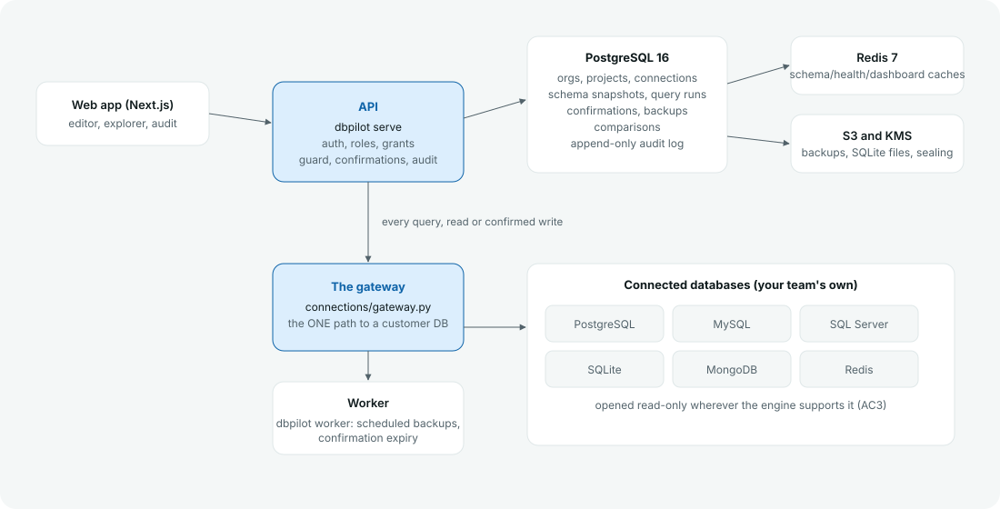
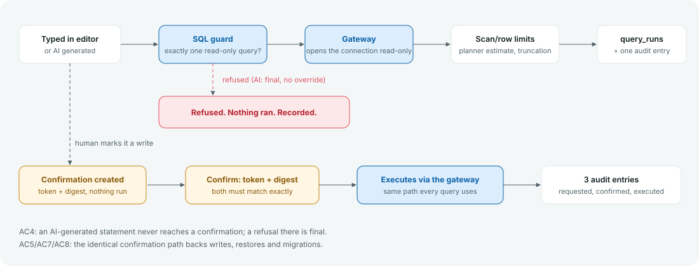

# High-level design

DBPilot is a self-hosted, team-shared database operations dashboard: a team registers a
connection once (PostgreSQL, MySQL, SQLite, SQL Server, MongoDB or Redis), and every
teammate who signs in can browse its schema, run queries, and watch its health, without
ever holding that database's own credential. This page is the map: the processes, how a
query flows, where state lives, how it is cached, and how it scales.
[LLD.md](LLD.md) goes into the code.

## Processes

| Process | Command | Does | Replicas |
| --- | --- | --- | --- |
| API | `dbpilot serve` | REST API under `/api/v1`: auth and sessions, connections, schema discovery, the SQL and NoSQL query surfaces, the AI assistant, confirmations, backups, schema comparisons, the audit log and dashboard aggregates | Any, stateless |
| Worker | `dbpilot worker` | Claims due backup schedules, runs them through the same backup path a manual backup uses, applies retention, and expires stale confirmations | Any, safe to run N replicas |
| Web | Next.js | The dashboard; calls the API at `API_INTERNAL_URL` | Any |
| Migrate | `dbpilot migrate` | Alembic migrations, a one-off container before `api` and `worker` start | One-off |
| Mock AI | `dbpilot mockai` | A deterministic model provider for local dev, tests and demo; never deployed to AWS | Any |

One Python package and one image (`infra/docker/server.Dockerfile`) serve the API, the
worker and the mock AI provider; the command given to the container picks the role
(`apps/api/src/dbpilot/cli.py`).

## A query, end to end

1. **Connect.** A connection is registered once (`POST /api/v1/connections`): kind, host
   and non-secret config, and a password that is sealed (envelope encryption, bound to the
   record id) and never returned by any API response afterward (AC1).
2. **Discover.** The explorer and the AI assistant both read the same schema snapshot,
   discovered from the live connection (tables/collections, columns, types, keys, indexes,
   row-count estimates) and cached (AC6).
3. **Ask or type.** A query is either typed by a person in the SQL editor (or the
   MongoDB/Redis read-only panel) or generated by the AI assistant from a natural-language
   prompt against the real discovered schema.
4. **Guard.** Every statement, human-typed or AI-generated, is parsed by the SQL guard
   (`queries/guard.py`, built on `sqlglot`) before it reaches the connector layer. An
   AI-generated statement that is not exactly one read-only query is refused here with no
   override anywhere (AC4). A human-typed statement that is not read-only must be
   explicitly marked as a write and goes to the confirmation step instead (AC5).
5. **Open, read-only.** The connection is opened by the gateway (`connections/gateway.py`,
   the only code path that reaches a customer database) with the engine's own read-only
   session setting wherever the engine has one, so a statement that somehow slipped past
   the guard still cannot write (AC3; see [security.md](security.md)).
6. **Limits.** Before a `SELECT` runs, its planner estimate is checked against the
   connection's `max_scan_rows`; a result over `max_rows` is truncated with
   `truncated: true` in the response, never silently dropped (AC2).
7. **Record.** Every run, accepted or refused, writes one `query_runs` row and one audit
   entry through the shared audit code path (AC10); an AI generation is kept in
   `ai_generations` whether it was accepted or refused.
8. **Confirmed writes, migrations and restores.** A human-marked write, a schema-comparison
   migration script, or a backup restore each creates a `confirmations` row (a one-time
   token plus a digest of exactly what will run) and only executes when that same token and
   digest are sent back, producing three audit entries: `*.requested`, `*.confirmed`,
   `*.executed` (AC5, AC7, AC8).

## State

| Store | Holds |
| --- | --- |
| PostgreSQL 16 | Everything durable: organizations, users, projects and roles, connections (with sealed secrets) and their grants, schema snapshots, query runs, saved queries, AI generations, confirmations, backups and backup schedules, schema comparisons, the append-only audit log, worker heartbeats |
| Object storage (S3, or local disk via `STORAGE=local`) | Uploaded SQLite files and backup dump files. Rows keep only a reference key, never the bytes |
| Redis 7 (optional; falls back to in-process memory) | The schema snapshot cache's fast layer, the connection health and dashboard aggregate response caches, query result pages for the editor, rate limits |
| KMS (or a local key, `KEY_MODE`) | Seals connection passwords and the AI provider key, bound to their record id |

## Caching

Every layer below degrades to a live read on a cache miss or a cache-store outage; nothing
depends on the cache to be correct, only to be fast.

| What | Where | Key | TTL | Invalidation |
| --- | --- | --- | --- | --- |
| A connection's schema snapshot | Redis (in-process memory without it) | `schema:<connection id>` | `SCHEMA_CACHE_TTL_S`, default 3600s (1 hour) | Explicit re-discover request, or a confirmed DDL write setting `connections.schema_invalidated_at` so the next read re-discovers regardless of TTL |
| A connection's health card | Redis response cache | `health:<connection id>` | `HEALTH_CACHE_TTL_S`, 15s | Time only; `?refresh=true` skips the cache and probes the engine live |
| The dashboard's org-wide aggregates | Redis response cache | `dashboard:<project id>` | `DASHBOARD_CACHE_TTL_S`, 15s | Time only; computed from a live query against DBPilot's own Postgres on a miss, never a worker-maintained rollup table |
| Query result pages (editor pagination, CSV export) | Redis (in-process memory without it) | `result:<query run id>:<page>` | `RESULT_TTL_S`, default 3600s | Never stale: a result is immutable once a query run finishes |
| Web data | TanStack Query in the browser | `["project", id, ...]` | `staleTime` per kind | Mutations invalidate exactly the keys they touch |

The schema cache's 1 hour TTL is long because discovery is the one connector call that
scans the live database's own metadata catalogs; the health and dashboard caches are a
short 15s because they report live reachability and counts a team is watching, not a
catalog that rarely changes. See `apps/api/src/dbpilot/schema/service.py`,
`monitoring/service.py` and `dashboard/service.py` for the read-through implementation.

## Scaling and failure

- The API is stateless; run as many replicas as needed behind a load balancer.
- The worker coordinates only through Postgres (`FOR UPDATE SKIP LOCKED` on backup
  schedules); safe to run N replicas, no in-process locks.
- A model provider outage fails only AI generation, never the read or write paths.
- A connected database outage fails only queries against that connection; its health card
  reports it rather than hiding it.
- Every statement against a connected database is bounded by that connection's
  `timeout_s`, enforced by the engine itself.

## Security boundaries

Covered in full in [security.md](security.md) and [threat-model.md](threat-model.md): the
SQL guard plus the database's own read-only session (two independent locks, AC3), sealed
credentials that are never returned by the API (AC1), an AI-generated statement with no
override path anywhere (AC4), a two-step confirm with a token and a digest for every write,
migration and restore (AC5, AC7, AC8), connection-level grants where an unauthorized lookup
is a 404 (AC9), and an audit log with one shared write path (AC10).
